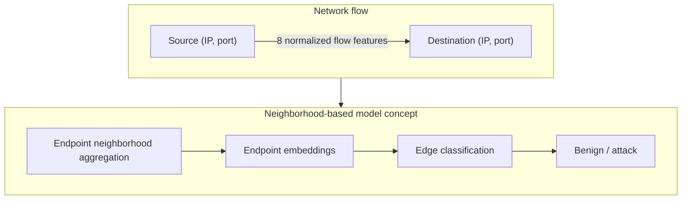

# E-GraphSAGE Network Intrusion Detection

A graph neural network research project for intrusion detection using NF-UNSW-NB15.

This project investigates benign-versus-attack classification of network traffic.
It represents `(IP address, port)` endpoints as nodes and network flows as edges,
then compares an MLP using individual flow features with simplified
E-GraphSAGE-style models using endpoint neighborhoods.

It is a simplified E-GraphSAGE-style implementation, not a full paper reproduction.

## Project Highlights

- End-to-end intrusion-detection pipeline: data preparation, graphs, training, and evaluation.
- NF-UNSW-NB15 with more than **1.6M raw network flows**.
- MLP and E-GraphSAGE-style models implemented with **PyTorch and PyTorch Geometric**.
- Leakage detection, train-only preprocessing, and duplicate-free fixed splits.
- Reproducible **five-seed evaluation** with validation-based checkpoint selection.
- **LOEO, hybrid, and shuffled-neighborhood ablations** to investigate the initial result.
- Main research result: controls did not establish useful neighborhood information
  as the source of the apparent GNN advantage in this setup.

## Research question

> **Does graph neighborhood information improve intrusion detection beyond the
> information already available in an individual flow?**

## Main results

All models use the same fixed split and five initialization seeds:
`42, 7, 21, 84, 123`. Values are mean test F1 ± **sample** standard deviation
across seeds. Attack is the positive class. Checkpoints are selected using
validation F1; each selected checkpoint is evaluated on test once per seed.

| Model | Mean Test F1 ± sample SD |
| --- | ---: |
| MLP — direct flow features | 0.977273 ± 0.000656 |
| Original E-GraphSAGE-style model | 0.980850 ± 0.002215 |
| Neighborhood-only LOEO GNN | 0.906368 ± 0.002616 |
| Direct flow + real LOEO neighborhoods | 0.974317 ± 0.004208 |
| Direct flow + shuffled neighborhoods | 0.981935 ± 0.000438 |

> **Main takeaway:** The original GNN appeared to outperform the MLP, but controlled ablations showed that the gain could not be attributed to useful graph-neighborhood information under this experimental setup.

The [five-model metric summary](results/shuffled_hybrid_multiseed/summary.json)
contains the saved comparison statistics. Detailed reports below include per-seed
metrics, confusion matrices, and protocols.

## Key finding

The original graph model scored slightly higher than the MLP in all five runs,
but it allowed the target flow's own features into its endpoint aggregation.
The follow-up controls changed the interpretation:

- Excluding the target flow with **leave-one-edge-out (LOEO)** aggregation caused
  a large drop for the neighborhood-only model.
- Adding real LOEO context alongside direct flow features did not outperform
  the MLP on average.
- Shuffled contexts outperformed the real-neighborhood hybrid in every paired
  seed, despite using the same hybrid architecture and training recipe.

**The tested neighborhood representation provides no clear evidence of reliable
incremental predictive value beyond direct flow features.** The controls do not
isolate a single cause of the original model's gain.

This conclusion applies to this dataset, fixed split, mean-aggregation architecture,
and batch evaluation setup; other graph models and evaluation settings may behave
differently.

## Dataset and preprocessing

The full **NF-UNSW-NB15** dataset contains **1,623,118 flows**:
1,550,712 benign and 72,406 attack. Experiments use a balanced development sample
of 20,000 flows, initially 10,000 per class.

Seven extra exact duplicate copies were removed before splitting, leaving
**19,993 unique complete rows**. The fixed, stratified splits contain:

- **Train:** 13,995 flows.
- **Validation:** 2,999 flows.
- **Test:** 2,999 flows.

There are no exact complete-row duplicates within or across these splits.
`log1p` is applied to byte counts, packet counts, and flow duration. Feature means
and population standard deviations are calculated from training data only and
applied unchanged to validation and test.

Splits remain fixed across training seeds. The balanced sample does not reflect
the original traffic class ratio.

See the [data preparation and graph checkpoint](results/README.md) for the
duplicate investigation, class counts, preprocessing verification, and graph
dimensions.

```text
Raw flows → balanced sample → deduplicate → fixed train / validation / test
          → train-fitted preprocessing → MLP / separate split graphs
          → validation-selected checkpoints → five-seed evaluation → ablations
```

## Graph representation

- **Node:** a network endpoint `(IP address, port)`.
- **Directed edge:** one network flow, from source to destination endpoint.
  Parallel and reverse-direction flows remain separate edges.
- **Initial node features:** constant vectors of ones; endpoint identities define
  connectivity rather than learned identity embeddings.
- **Labels:** `0 = benign`, `1 = attack`. Labels are never model inputs.



Each edge has eight normalized features, in this order:

1. `PROTOCOL`
2. `L7_PROTO`
3. `IN_BYTES`
4. `OUT_BYTES`
5. `IN_PKTS`
6. `OUT_PKTS`
7. `TCP_FLAGS`
8. `FLOW_DURATION_MILLISECONDS`

The [graph builder](src/build_nf_unsw_graphs.py) creates a separate PyTorch
Geometric `Data` object for each split. The original model averages incident
edge features at each endpoint, learns endpoint embeddings, and classifies their
concatenation. LOEO variants exclude the current target edge from both endpoint
contexts, including both incidences of a self-loop.

## Experiments

- **MLP baseline:** classifies direct flow features without graph context.
  Its repeated runs are recorded in the [multi-seed report](results/multiseed/report.md).
- **Original E-GraphSAGE-style model:** uses mean aggregation with the target
  included. The [initial experiment report](results/egraphsage_experiment.md)
  describes its architecture and first training run.
- **Five-seed comparison:** repeats MLP and original GNN training with fixed data
  and validation-only checkpoint selection. The
  [comparison report](results/multiseed/report.md) documents the different training
  budgets and paired results.
- **Neighborhood-only LOEO:** removes the target's contribution and classifies
  using the remaining endpoint contexts. See the
  [LOEO report](results/loeo_multiseed/report.md).
- **Direct-flow + real-context hybrid:** combines direct flow features with LOEO
  endpoint embeddings. The [hybrid report](results/hybrid_multiseed/report.md)
  includes performance for empty and non-empty neighborhoods.
- **Shuffled-neighborhood control:** reassigns paired LOEO context embeddings
  between flows while keeping target features, labels, architecture, and training
  unchanged. The [control report](results/shuffled_hybrid_multiseed/report.md)
  includes assignment checks, subgroup analysis, and control limitations.

## Repository structure

```text
.
├── src/                # 14 active data, graph, model, and experiment modules
├── tests/              # Aggregation, model, and evaluation-protocol checks
├── examples/           # Toy progression, optional inspection, historical archive
├── results/            # Experiment reports, metrics, and training histories
├── data/
│   ├── README.md       # Dataset placement, provenance, and checksums
│   ├── toy_flows.csv   # Intentionally tracked educational fixture
│   ├── raw/            # Local raw datasets (ignored)
│   └── processed/      # Generated samples and splits (ignored)
├── requirements.txt    # Recorded Python environment
└── README.md
```

Raw NF-UNSW-NB15 data, generated processed CSVs, and model checkpoint binaries are
excluded from Git. The reports and saved JSON metrics document the experiments
without requiring those binaries.

See [examples/README.md](examples/README.md) for the educational progression and
historical archive, and [data/README.md](data/README.md) for dataset placement and
provenance. The active research commands below remain in `src/`.

## Reproduction

Recorded experiments ran on **CPU** in Ubuntu under WSL with Python 3.12.
From the repository root in WSL/Linux, create and activate an environment:

```bash
python3 -m venv .venv
source .venv/bin/activate
python -m pip install -r requirements.txt
export OMP_NUM_THREADS=1 MKL_NUM_THREADS=1
```

[requirements.txt](requirements.txt) records the existing environment, including
CUDA packages, although these experiment scripts execute on CPU. It is an
environment snapshot rather than a minimal CPU dependency list.

### Tests

After data preparation (see the expandable instructions below), run the
[test suite](tests/):

```bash
python -B -m unittest discover -s tests -p 'test_*.py' -v
```

The suite checks target exclusion, parallel/reverse edges, self-loops, label
independence, finite gradients, deterministic shuffling, and validation-only
checkpoint selection. Some protocol checks also read the prepared split files.

<details>
<summary>Full reproduction: data preparation and experiment run order</summary>

### Prepare data and verify graphs

Supply `NF-UNSW-NB15.csv` under `data/raw/nf_unsw_nb15/` (nested directories are
supported; exactly one matching CSV is expected). For a new reproduction, run:

```bash
python -B src/create_nf_unsw_sample.py
python -B src/split_nf_unsw_sample.py
python -B src/preprocess_nf_unsw_splits.py
python -B src/build_nf_unsw_graphs.py
```

These preparation commands write the sample and processed CSVs. When using the
existing prepared data, skip them to retain the verified split. The graph builder
checks all three graphs in memory; experiment runners load the normalized CSVs
and construct their graphs through the same implementation.

### Run experiments

The experiment runners use fixed output directories and **refuse to overwrite
existing results**. To repeat all experiments, use a separate reproduction copy
and archive its existing `results/multiseed/`, `results/loeo_multiseed/`,
`results/hybrid_multiseed/`, and `results/shuffled_hybrid_multiseed/` directories
outside that copy first. Keep the provided historical reports in the original
checkout. Then run in this order, as later comparisons read earlier summaries:

```bash
python -B src/run_multiseed_experiment.py          # MLP and original GNN
python -B src/run_loeo_experiment.py              # Neighborhood-only LOEO
python -B src/run_hybrid_experiment.py            # Direct features + real LOEO
python -B src/run_shuffled_hybrid_experiment.py   # Shuffled-context control
```

All four runners use the five seeds listed above. Training settings and model
sizes differ between the MLP and GNN variants; the linked reports document them.
Each seed restores its best-validation checkpoint before its single test
evaluation. Results are saved separately for each experiment and seed.

</details>

## Technologies and skills

**Python, PyTorch, PyTorch Geometric, pandas, NumPy, and scikit-learn.**
The project combines GNNs and graph-based network analysis with intrusion
detection, feature preprocessing, model evaluation, reproducible multi-seed
experiments, ablation studies, leakage investigation, and unit testing.

## Limitations and future work

- **Random flow split:** endpoints and related traffic can appear across splits.
  Exact-row deduplication does not provide endpoint-disjoint evaluation.
- **Batch/transductive-style evaluation:** validation/test predictions use other
  flows from their own split. The entire traffic batch is assumed available;
  this does not measure real-time causal IDS performance.
- **Simple representation:** mean aggregation can lose neighborhood structure
  and direction-specific information. The original model also reuses the target
  flow through aggregation.
- **Limited scope:** five seeds on one balanced NF-UNSW-NB15 development split
  measure training variability within this setup, not generalization across
  datasets, splits, or deployment conditions.
- **Control interpretation:** the shuffled result does not prove that random
  contexts contain meaningful information. Shuffling changes context availability
  per flow, and the [control report](results/shuffled_hybrid_multiseed/report.md)
  documents chance endpoint overlap and other ambiguities.
- **Comparison confounds:** model capacity and training recipes differ across
  the MLP and GNN variants. The real and shuffled hybrids are matched to each
  other, but the experiments do not identify a unique mechanism for the shuffled
  model's higher score.

Future work could use endpoint-disjoint and temporal splits, streaming evaluation
with only previously observed context, alternative GraphSAGE/message-passing
aggregation, larger or full-dataset experiments, and capacity-matched baselines.
